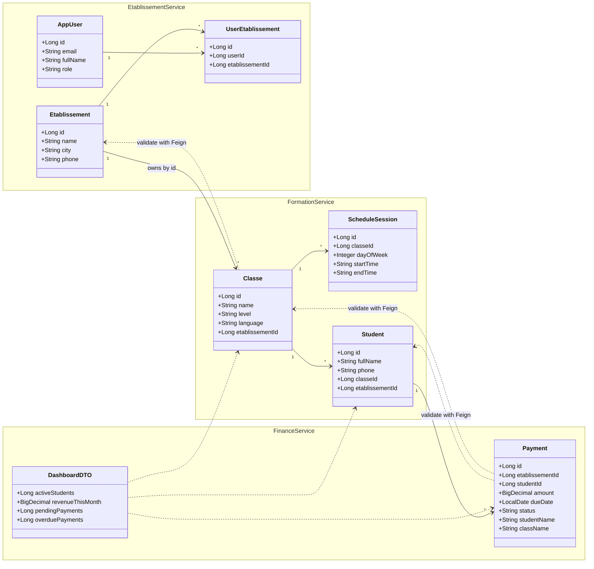
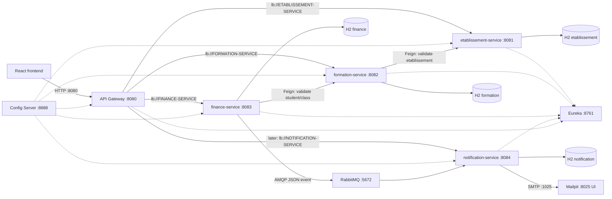

# EduCenterERP

EduCenterERP is a language-center management application: students, classes, weekly sessions, establishments, users, payments and a dashboard. The frontend is React + TypeScript + Vite; the backend is Spring Boot 3.5 with H2. Supabase was removed in the `v0.0` baseline.

The microservices work is applied progressively from Jalon 00 to Jalon 06. The detailed objectives are in [`documentation/googledrivetps.md`](documentation/googledrivetps.md).

## Current state vs target

- `v0.0`: one Spring Boot backend, one H2 database, frontend calling `http://localhost:8080`.
- `v0.1`: project presentation and target diagrams.
- `v1.0`: Jalon 01 applied: 3 independent business services, 3 H2 databases and a static API Gateway on `:8080`.
- `v2.0`: Jalon 02 applied: Eureka on `:8761` and discovery-based Gateway using `lb://` routes.
- `v3.0`: Jalon 03 applied: Config Server on `:8888` with native YAMLs and local fallback.
- `v4.0`: Jalon 04 applied: Feign validation, enriched payment views, idempotency keys and 502 mapping.

The diagrams below describe the target architecture. Jalon 04 implements Feign validation and idempotency on top of centralized configuration; RabbitMQ, circuit breakers and retries remain later milestones.

## Business class diagram



Solid arrows are local ownership inside one service. Dashed arrows (`..>`) are cross-service dependencies; since Jalon 04 they are Feign calls through Eureka, not JPA joins.

## Target architecture



The frontend keeps calling `:8080`; the Gateway is the only public entrypoint. Eureka handles discovery, Config Server handles external configuration, RabbitMQ decouples e-mail side effects from payment commits.

## Repository layout

```text
EduCenterERP/
  documentation/
    googledrivetps.md                  Jalon objectives and consequences
    drivelink.md                       Google Drive folder link
    postman/EduCenterERP.postman_collection.json
  educenter-backend/
    common/                            Shared DTOs, validation, exception handler, OpenAPI config
    config-server/                     Centralized configuration - :8888
    eureka-server/                     Service registry - :8761
    etablissement-service/             Users, etablissements, memberships - :8081
    formation-service/                 Classes, sessions, students - :8082
    finance-service/                   Payments, dashboard - :8083
    api-gateway/                       Discovery-based routes - :8080
  educenter-frontend/                  React + TypeScript client
  README.md                            This file
```

## Run Jalon 04

```powershell
$env:JAVA_HOME="C:\Program Files\Eclipse Adoptium\jdk-25.0.4.101-hotspot"
.\mvnw.cmd clean install
```

Start Config Server first, then Eureka, the business services and the gateway. Run each command in a separate terminal from `educenter-backend/`:

```powershell
.\mvnw.cmd -pl config-server spring-boot:run
.\mvnw.cmd -pl eureka-server spring-boot:run
.\mvnw.cmd -pl etablissement-service spring-boot:run
.\mvnw.cmd -pl formation-service spring-boot:run
.\mvnw.cmd -pl finance-service spring-boot:run
.\mvnw.cmd -pl api-gateway spring-boot:run
```

Config Server health: `http://localhost:8888/actuator/health`; a resolved service config is available at `http://localhost:8888/api-gateway/default`. Eureka dashboard: `http://localhost:8761/`. Gateway actuator health: `http://localhost:8080/actuator/health`. Discovery-based routes: `http://localhost:8080/actuator/gateway/routes`. Swagger UI remains directly available at `http://localhost:8081/swagger-ui.html`, `:8082/swagger-ui.html` and `:8083/swagger-ui.html`.

Each service imports `optional:configserver:http://localhost:8888`; when Config Server is unavailable, the local `application.properties` values remain the fallback. CORS is configured once in the gateway; business services no longer declare browser CORS rules. Gateway routes use Eureka service IDs (`lb://...`) instead of `localhost:808x`.

Jalon 04 behavior: finance calls formation with Feign to validate a payment's student and class, then calls etablissement-service to resolve the établissement label returned as `etablissement_id` / `etablissement_name`. Formation calls etablissement-service when creating/updating classes and students, and finance-service when deleting students with payments. Unknown remote entities still produce `404`; an unavailable remote service produces `502`. POST `/api/payments`, `/api/classes`, `/api/students`, `/api/sessions` and `/api/sessions/classes/{classId}` accept an optional `Idempotency-Key` header: replaying the same key and body returns the first response without a duplicate write, while reusing a key with a different body returns `409`.

PDF receipts require Python and `reportlab`: `python -m pip install -r educenter-backend/finance-service/scripts/requirements.txt`.

```powershell
npm install
npm run dev
```

Frontend API base URL: `VITE_API_BASE_URL` (default `http://localhost:8080`). Import [`documentation/postman/EduCenterERP.postman_collection.json`](documentation/postman/EduCenterERP.postman_collection.json) for discovery, smoke and write checks.

## Jalon map

| Jalon | Tag | Main consequence |
|---|---|---|
| 00 | `v0.1` | This README, UML class diagram, target architecture diagram |
| 01 | `v1.0` | 3 independent business services, own H2 databases, static Gateway, DTO validation |
| 02 | `v2.0` | Eureka + Gateway dynamic routing |
| 03 | `v3.0` | Centralized Config Server |
| 04 | `v4.0` | Feign validation, enriched views, idempotency keys |
| 05 | `v5.0` | RabbitMQ + Mailpit notification service |
| 06 | `v6.0` | Circuit breaker, retry, timeouts, centralized error handling |

Jalon 07 (Kafka) is recorded in the objectives document but is out of scope for now.
