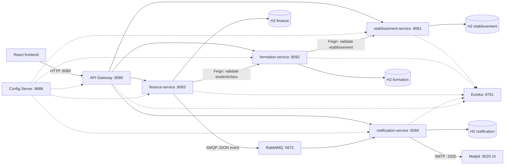

# EduCenterERP

EduCenterERP is a language-center management application: students, classes, weekly sessions, establishments, users, payments and a dashboard. The frontend is React + TypeScript + Vite; the backend is Spring Boot 3.5 with H2. Supabase was removed in the `v0.0` baseline.

The microservices work is applied progressively from Jalon 00 to Jalon 06. The detailed objectives are in [`documentation/googledrivetps.md`](documentation/googledrivetps.md).

## Current state vs target

- `v0.0`: one Spring Boot backend, one H2 database, frontend calling `http://localhost:8080`.
- `v0.1`: project presentation and target diagrams (this document).
- `v1.0+`: business services, then Gateway, Config Server, Feign, RabbitMQ and resilience.

The diagrams below describe the **target architecture**; they are the Jalon 00 deliverable.

## Business class diagram


Solid arrows are local ownership inside one service. Dashed arrows (`..>`) are cross-service dependencies; after Jalon 01 they become REST/Feign calls, not JPA joins.

## Target architecture



The frontend keeps calling `:8080`; the Gateway is the only public entrypoint. Eureka handles discovery, Config Server handles external configuration, RabbitMQ decouples e-mail side effects from payment commits.

## Repository layout

```text
EduCenterERP/
  documentation/     Drive links, Jalon objectives, notes
  educenter-backend/ Spring Boot code (becomes multi-module in Jalon 01)
  educenter-frontend/ React + TypeScript client
  README.md          This file
```

## Run the baseline

```powershell
$env:JAVA_HOME="C:\Program Files\Eclipse Adoptium\jdk-25.0.4.101-hotspot"
.\mvnw.cmd spring-boot:run
```

```powershell
npm install
npm run dev
```

Frontend API base URL: `VITE_API_BASE_URL` (default `http://localhost:8080`).

## Jalon map

| Jalon | Tag | Main consequence |
|---|---|---|
| 00 | `v0.1` | This README, UML class diagram, target architecture diagram |
| 01 | `v1.0` | 3 independent business services, own H2 databases, DTO validation |
| 02 | `v2.0` | Eureka + Gateway dynamic routing |
| 03 | `v3.0` | Centralized Config Server |
| 04 | `v4.0` | Feign validation, enriched views, idempotency keys |
| 05 | `v5.0` | RabbitMQ + Mailpit notification service |
| 06 | `v6.0` | Circuit breaker, retry, timeouts, centralized error handling |

Jalon 07 (Kafka) is recorded in the objectives document but is out of scope for now.
